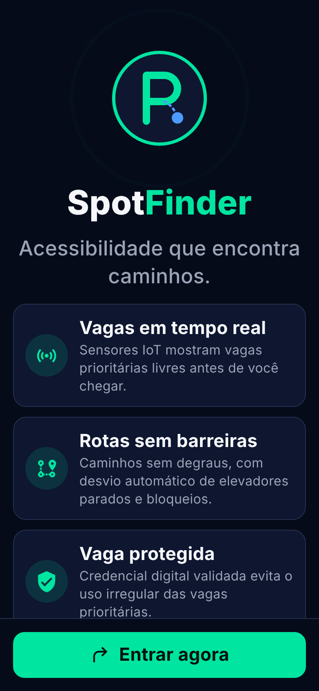
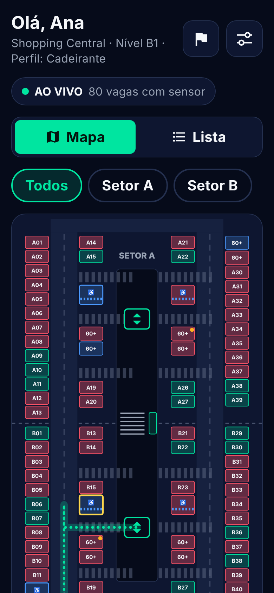
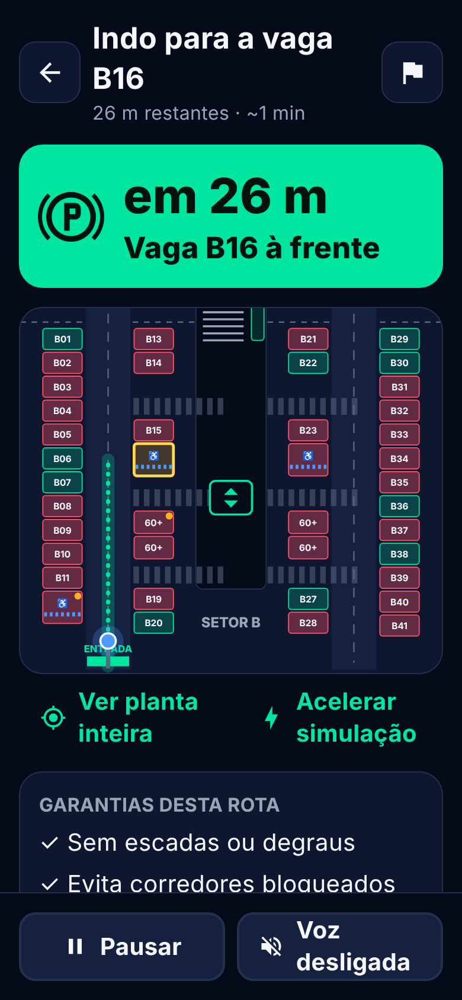
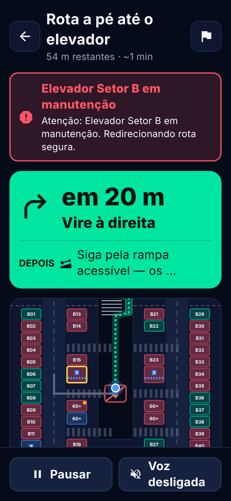
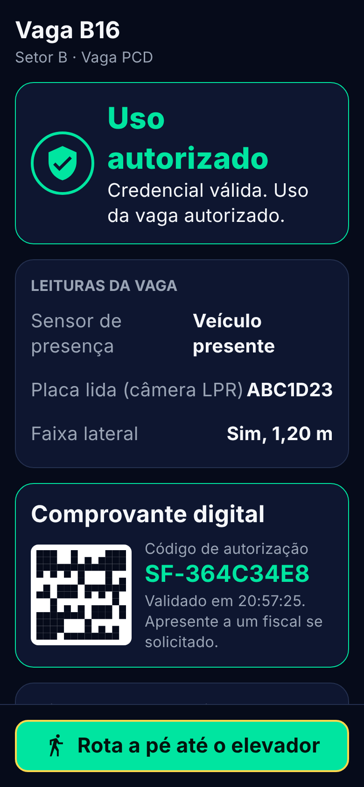

# SpotFinder

**Acessibilidade que encontra caminhos.** App mobile (React Native + Expo + TypeScript) para gestão inteligente de vagas prioritárias (PCD e idosos) e rotas acessíveis em estacionamentos de shoppings, aeroportos e hospitais.

| Splash | Dashboard | Navegação | Re-roteamento | Antifraude |
|---|---|---|---|---|
|  |  |  |  |  |

## Como rodar

```bash
npm install
npm start          # Expo Go (Android/iOS) — ou: npm run web
npm test           # testes de domínio (roteamento, recomendação, antifraude)
npm run typecheck
```

Demonstração: escolha **Cadeirante**, credencial `SP-PCD-123456`, placa `ABC1D23`.
Aos ~25 s o simulador IoT coloca o **Elevador B em manutenção**, e aos ~45 s bloqueia uma faixa de pedestres no Setor B. Para disparar na hora, use o **Painel de simulação IoT** no fim do Dashboard. Na navegação, **Acelerar simulação** triplica a velocidade.

## Arquitetura

```
App.tsx                         # hidratação do store, ThemeProvider, ponte IoT → store
src/
├── types/                      # modelo de domínio (vaga, grafo, elevador, perfil, credencial)
├── data/
│   ├── mockFacility.ts         # gerador da planta B1: vagas + grafo de rotas (determinístico)
│   └── profiles.ts             # perfis de acessibilidade e seus pesos
├── services/                   # lógica pura, sem React — testável e portável p/ backend
│   ├── iot/sensorHub.ts        # contrato SensorHub/SensorEvent (trocar por MQTT/WebSocket)
│   ├── iot/mockSensorHub.ts    # simulador: vagas, elevadores, bloqueios + incidentes roteirizados
│   ├── routing/pathfinder.ts   # Dijkstra multi-destino com heap; filtra degraus/bloqueios/modo
│   ├── routing/instructions.ts # rota → manobras ("vire à direita", "siga pela rampa")
│   ├── recommendation/         # score de vaga por perfil (caminhada × peso + carro × peso)
│   ├── credential/             # validação antifraude (formato, validade, categoria, placa LPR)
│   └── voice/voiceGuide.ts     # TTS pt-BR + leitor de tela + háptico em um único canal
├── store/useAppStore.ts        # Zustand: estado em tempo real + persistência (perfil/ajustes)
├── hooks/                      # useSensorFeed, useRecommendations, useIndoorPositioning, useAnnouncer
├── theme/                      # tokens (paleta escura + alto contraste), escala de fonte
├── components/                 # ParkingMap (SVG), AccessibleButton, InstructionPanel, AlertBanner…
├── navigation/                 # native-stack tipado
└── screens/                    # Splash, ProfileSetup, Dashboard, Navigation, Verification,
                                # ReportObstacle, Settings
```

### Fluxo de dados

```
Sensores (mock/MQTT) ──SensorEvent[]──▶ store.applySensorEvents ──▶ facility (imutável)
                                              │                      graphVersion++ (se afeta rota)
                                              ▼                      alerts[]
                     useRecommendations ◀─ facility        NavigationScreen ◀─ graphVersion
                     (recalcula a cada leitura)            (re-roteia só se a rota ótima mudou)
```

- **Planta como grafo**: corredores de veículo (`vehicle`), passarela/faixas (`pedestrian`) e trechos compartilhados (`shared`). Arestas têm `hasStairs` e `blocked`. Os degraus entre setores têm um desvio por **rampa** — os testes garantem que perfis com restrição nunca passam por degraus.
- **Recomendação**: para cada vaga livre compatível (cadeirante exige faixa lateral), calcula rota de carro desde a entrada e rota a pé até o **elevador operante mais próximo**. Idoso/mobilidade reduzida tem peso de caminhada maior. Sem vaga prioritária livre → sugere vaga comum (`fallback`).
- **Re-roteamento**: quando `graphVersion` muda, a tela recalcula a partir do próximo nó e só troca a rota (e avisa por voz) se a melhor rota restante mudou.
- **Reserva**: a vaga escolhida fica `reserved`; leituras do sensor não a sobrescrevem até a validação.
- **Antifraude**: sensor detecta o veículo → janela de 3 min para validar credencial (formato, validade, categoria da vaga, placa lida pela câmera LPR) → comprovante com token. Tempo esgotado gera alerta para a administração. No mapa, ponto laranja = vaga prioritária ocupada sem validação.
- **Comunidade**: relatos de passagem bloqueada / piso escorregadio no trecho atual entram no grafo como bloqueio; "elevador parado" coloca o elevador do setor em manutenção.

### Acessibilidade do próprio app

- Contraste AAA na paleta padrão + modo **alto contraste** (preto puro, bordas brancas).
- **Escala de fonte própria** (100–160%), somada à do sistema com teto para não quebrar o layout.
- Alvos de toque de 48–64 dp; `accessibilityRole/State/Hint` em todos os controles; ícones ocultos do leitor de tela.
- Mapa SVG exposto como **uma imagem com descrição resumida** + **visão em lista** equivalente para navegar vaga a vaga.
- Alertas com `accessibilityLiveRegion` e anúncio via `announceForAccessibility`; navegação por **voz pt-BR** e **vibração** nas manobras (padrão no perfil de deficiência visual).
- Legenda nunca depende só de cor (♿, 60+, contagens em texto). Respeita "reduzir movimento".

## Próximos passos para produção

1. **IoT real**: implementar `SensorHub` sobre MQTT (ex.: AWS IoT Core) ou WebSocket do backend; o resto do app não muda.
2. **Posicionamento interno**: trocar `useIndoorPositioning` por beacons BLE/UWB com trilateração + *map matching* no grafo.
3. **Backend**: API de credenciais integrada a DETRAN/prefeitura (token JWT assinado), reserva com TTL no servidor, moderação de relatos por confirmações.
4. **Multi-nível**: `ParkingFacility.levels` já é uma lista — falta conectar os níveis pelos elevadores no grafo.
5. Planta por estabelecimento importada de CAD/GeoJSON em vez do gerador mock.
